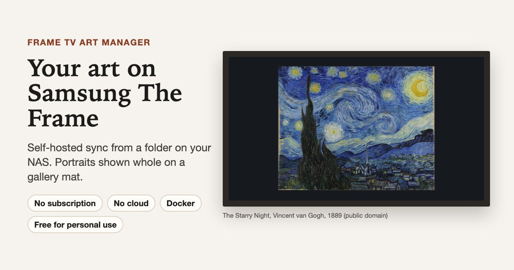

# Frame TV Art Manager

[](https://github.com/MikeO7/frame-tv-art-manager/actions/workflows/ci.yml)
[](https://mikeo7.github.io/frame-tv-art-manager/)

[](https://mikeo7.github.io/frame-tv-art-manager/)

**Keep your Samsung Frame TV's art in sync with a folder on your home server.**

Frame TV Art Manager is a self-hosted service that automatically uploads your
photos and artwork to Samsung Frame TVs (The Frame) from a NAS or home server.
Drop JPEG or PNG files into a folder; it prepares them for the 4K screen and
keeps every Frame TV in your house up to date over your local network, without
SmartThings or a Samsung account. When a TV runs out of space, it rotates your
collection through automatically. It runs in Docker and is free for personal,
noncommercial use.

[Project website](https://mikeo7.github.io/frame-tv-art-manager/) ·
[Quick start](#quick-start-with-docker-compose) ·
[Apple Photos guide](https://mikeo7.github.io/frame-tv-art-manager/guides/apple-photos-to-samsung-frame-tv.html) ·
[All settings](.env.example)

Guides:
[Synology, Unraid, and TrueNAS](https://mikeo7.github.io/frame-tv-art-manager/guides/frame-tv-art-synology-unraid-truenas.html) ·
[Portraits and gallery mats](https://mikeo7.github.io/frame-tv-art-manager/guides/samsung-frame-tv-portrait-photos-mat.html) ·
[Free public-domain art](https://mikeo7.github.io/frame-tv-art-manager/guides/free-public-domain-art-samsung-frame-tv.html) ·
[Seasonal collections](https://mikeo7.github.io/frame-tv-art-manager/guides/seasonal-art-collections-samsung-frame-tv.html) ·
[AI art with MCP](https://mikeo7.github.io/frame-tv-art-manager/guides/ai-art-samsung-frame-tv-mcp.html) ·
[Art size (3840×2160)](https://mikeo7.github.io/frame-tv-art-manager/guides/samsung-frame-tv-art-size.html) ·
[Home Assistant](https://mikeo7.github.io/frame-tv-art-manager/guides/home-assistant-samsung-frame-tv-art.html) ·
[Troubleshooting](https://mikeo7.github.io/frame-tv-art-manager/guides/samsung-frame-tv-art-mode-troubleshooting.html)

> [!IMPORTANT]
> This is source-available software under the
> [PolyForm Noncommercial License 1.0.0](LICENSE), not an open-source license.
> Personal and other noncommercial use is allowed; commercial use is not. The
> project is independent and not affiliated with or endorsed by Samsung.

## Features

- **Folder in, art on the TV.** Add or remove files and the TV follows on the
  next sync. Unchanged files are never uploaded twice.
- **Several TVs, one collection.** List every TV's address and each one is kept
  in sync on its own.
- **Ready for the screen.** Photos are rotated upright, cropped or padded to
  fit, color-corrected, gently sharpened, and saved at 3840×2160 by default.
- **Automatic rotation when the TV is full.** Each piece stays up for two weeks
  (configurable), then makes room for art that hasn't been shown yet.
- **Many ways to add art.** A local folder, a password-protected web uploader
  (works with iPhone Shortcuts), or online sources: public-domain paintings
  from the Art Institute of Chicago, The Met, the Cleveland Museum of Art, and
  SMK (no API keys needed), Wikimedia Commons' Picture of the Day and Featured
  Pictures, Unsplash, NASA, Pexels, Pixabay, and direct image links.
- **Careful by default.** It only removes art it uploaded, leaves your own TV
  uploads alone, and makes no changes when it can't be sure of the TV's state.
- **Themed collections.** Show your Christmas art from Dec 1 to Jan 6, then
  go back to the everyday rotation automatically.
- **Works with AI assistants.** An optional MCP endpoint lets Claude or another
  assistant create or find art, preview how it will look, and schedule it. The
  manager needs no AI keys.
- **Your art rotates without a subscription.** The manager changes the picture
  itself every 15 minutes by default, shuffling through everything before
  repeating. Samsung's own slideshow of your photos now asks for an Art Store
  subscription on current firmware.
- **Optional TV controls.** Fixed or sun-following brightness, a nightly
  power-off time, and Wake-on-LAN.

## Is it right for you?

You need:

- A Samsung Frame TV running **Tizen 8.0 or newer**. Older firmware may
  work, but Samsung's private Art Mode protocol changes between models and
  releases.
- Something that runs all the time and can reach the TV on your network: a
  NAS (Synology, Unraid, TrueNAS), a mini PC, a Raspberry Pi–class Linux box,
  or a Mac.
- A fixed IP address for the TV (set a DHCP reservation in your router).

If you only upload the occasional photo from your phone, Samsung's SmartThings
app is simpler. This project is for people who want a collection that keeps
itself up to date.

## Quick start with Docker Compose

Create a folder for the service and save this as `compose.yaml`:

```yaml
services:
  frame-tv-art-manager:
    image: ghcr.io/mikeo7/frame-tv-art-manager:latest
    container_name: frame-tv-art-manager
    restart: unless-stopped
    environment:
      TV_IPS: "192.168.1.150"        # your TV's address; comma-separate several
      CLIENT_NAME: "Frame Art Manager"
    ports:
      - "8080:8080"
    volumes:
      - ./data:/data
```

Start it and watch the logs:

```bash
docker compose up -d
docker compose logs -f frame-tv-art-manager
```

1. **Approve the connection.** The first time it connects, the TV shows an
   Allow/Deny prompt named after `CLIENT_NAME`. Choose **Allow** with the remote.
   The manager pairs on the TV's remote-control channel first, so one approval
   covers both artwork and power control. The pairing token is saved in
   `./data/tokens`; keep that folder when you upgrade or the TV will ask again.
2. **Add art.** Copy `.jpg`, `.jpeg`, or `.png` files into `./data/artwork`.
   Each file is replaced by its prepared version, and the untouched original
   is kept in the hidden `.frame-tv-art-manager` folder beside it.
3. **Wait for a sync.** The first sync runs at startup, then every 30 minutes
   (`SYNC_INTERVAL_MINUTES`).

The image runs on `amd64`, `arm64`, and `armv7`. If the container can't write to
`./data`, create the folders yourself with `mkdir -p data/artwork data/tokens`.
To set file ownership, use `PUID` and `PGID`. To run as a non-root user instead,
own both folders yourself, add `user: "<uid>:<gid>"` to the service, and leave
`PUID`/`PGID` unset.

## Adding artwork

### A folder

The `artwork` folder is your collection. Add files to put them on the TV and
delete files to take them off. Identical files are detected by their contents,
so the same image is never uploaded twice. Other files in the folder (JSON,
YAML, hidden and temporary files, symlinks) are ignored.

With image preparation on (the default), each file that needs work is
**replaced in place** by its prepared 3840×2160 version and renamed to a
readable name plus a short content hash, for example
`summer-vacation--8f14e45fceea167a.jpg`. The untouched original is kept in
`.frame-tv-art-manager/originals` inside the folder (see
[Kept originals](#kept-originals)). Rename or delete the prepared file as you
would any other; adding a file with the same name replaces it and its
original.

### The web uploader

Turn on the built-in upload page:

```yaml
    environment:
      UPLOAD_ENABLED: "true"
      UPLOAD_TOKEN: "a-long-random-password"   # at least 16 characters
```

Then open `http://<server-address>:8080/upload`, sign in as `frame` with your
`UPLOAD_TOKEN`, and choose JPEG or PNG files. The same address accepts a
multipart `POST` with a field named `file`, so iPhone and Mac Shortcuts and
`curl` work too:

```bash
curl -u "frame:$UPLOAD_TOKEN" -F "file=@photo.jpg" http://<server-address>:8080/upload
```

Each upload is checked as a real image and is limited to
`MAX_DOWNLOAD_SIZE_MB` (20 MB by default). Uploads are handled one at a time;
a second upload sent at the same moment gets `429 Too Many Requests` and
should be retried. When the folder already holds `MAX_ARTWORK_IMAGES` images,
an upload gets `409 Conflict`. An uploaded image reaches the TV on the next
sync cycle (`SYNC_INTERVAL_MINUTES`), not immediately. After 10 wrong
passwords in a minute from one address, the server answers `429` with a
`Retry-After` header for the rest of that minute. Behind a reverse proxy every
client shares the proxy's address and therefore that budget. The page uses plain HTTP Basic
authentication, so keep it on your home network or behind a TLS reverse proxy,
and never expose port 8080 to the internet. The
[Apple Photos guide](https://mikeo7.github.io/frame-tv-art-manager/guides/apple-photos-to-samsung-frame-tv.html)
walks through iPhone, iPad, and Mac setups; the repository keeps
[detailed notes](docs/apple-photos-sync.md).

### Online sources

Point `ARTWORK_SOURCES_FILE` at a YAML file in your data folder, for example
`ARTWORK_SOURCES_FILE=/data/sources.yaml`. If the file doesn't exist, a
commented starter file is created for you.

```yaml
providers:
  unsplash:
    - collection:225444
    - photo:L9W_5q57_V8
  nasa:
    - apod
    - search:james webb
  art_institute_of_chicago:
    - search:monet
    - photo:20684
  met:
    - search:sunflowers
    - search:?isHighlight=true&departmentId=11
    - object:436524
  cleveland:
    - search:snow?type=Painting
    - object:1997.111
  smk:
    - search:hammershøi
    - object:KMS1
  museum:
    - search:christmas
  commons:
    - potd
    - featured
    - search:northern lights
  pexels:
    - curated
    - search:architecture
  pixabay:
    - editors_choice
    - search:mountains
  direct:
    - https://example.com/image.jpg
```

| Provider | Commands | What you get | API key |
| --- | --- | --- | --- |
| Unsplash | `collection`, `photo` | up to 990 photos per collection | `UNSPLASH_ACCESS_KEY` |
| NASA | `apod`, `search` | today's picture (skipped on video days); the first 10 library results | `NASA_API_KEY` (defaults to `DEMO_KEY`) |
| Art Institute of Chicago | `search`, `photo` | public-domain works only; the first 10 search results | none |
| The Met (`met`) | `search`, `object` | public-domain works only; the first 10 search results with an open-access image | none |
| Cleveland Museum of Art (`cleveland`) | `search`, `object` | CC0 works only; the first 10 search results | none |
| SMK, National Gallery of Denmark (`smk`) | `search`, `object` | public-domain works only; the first 10 search results | none |
| All four museums (`museum`) | `search` | up to 20 public-domain works for a theme, mixed across the museums above | none |
| Wikimedia Commons (`commons`) | `potd`, `featured`, `search` | today's Picture of the Day; the 10 newest Featured Pictures; 10 Featured Pictures matching a query | none |
| Pexels | `search`, `curated`, `collection`, `photo` | 10 search or curated results; up to 800 per collection | `PEXELS_API_KEY` |
| Pixabay | `search`, `editors_choice`, `photo` | up to 500 photos at least 3840 pixels wide | `PIXABAY_API_KEY` |
| Direct link | any HTTP or HTTPS image URL | that image | none |

Museum searches can be narrowed with filters after a `?`, written as
`name=value` pairs joined by `&`. The query before the `?` may be empty when a
filter is given:

- **The Met:** `departmentId`, `isHighlight`, `isOnView`, `artistOrCulture`,
  `title`, `tags`, `medium`, `geoLocation`, `dateBegin`, `dateEnd` (the Met's
  [search parameters](https://metmuseum.github.io/#search-v11); department IDs
  come from its `/departments` endpoint).
- **Cleveland:** `type` (such as `Painting` or `Print`), `department`,
  `highlight`, `artists`, `title`, `created_after`, `created_before`,
  `currently_on_view`.
- **SMK** takes no filters.

Unknown filters are rejected, so a typo can't widen a search, and the
public-domain and has-image filters are always applied. IDs come from each
work's page: `metmuseum.org/art/collection/search/436524` → `436524`;
`clevelandart.org/art/1997.111` → `1997.111` (the numeric ID works too);
`open.smk.dk/artwork/image/KMS1` → `KMS1`.

`museum:search:<theme>` searches all four museums at once and mixes their
results, dropping the same title by the same artist when two museums hold
copies (common for prints). If one museum is down, the others' works are still
used. The Picture of the Day changes at midnight UTC, so `commons:potd` adds one
picture a day; `commons:search` only searches Featured Pictures.

A plain list, a top-level `sources:` list, or a text file with one source per
line (`#` for comments) also works. The sources file may be a symlink, so a
Kubernetes ConfigMap or Docker config mount works. Downloads go into your
collection like any other file. If any source fails during a sync, nothing
previously downloaded is removed. Removing a source from the file doesn't
delete what it already downloaded; delete those files yourself if you no
longer want them.

Each provider has its own rate limits and terms, so the manager asks each one
as little as possible:

- **Results are cached for 24 hours** (APOD and the Commons Picture of the Day
  until the next day) in
  `.frame-tv-art-manager/source-state.json` inside the artwork folder. Pixabay
  requires this. Restarts reuse the cache.
- **Rate limits are respected.** When a provider answers `429` or reports no
  requests left, it isn't asked again until its `Retry-After` or reset time.
  Other failures are retried after 15 minutes, doubling up to a day.
- **A failing provider keeps its last good results**, so a provider outage or
  quota doesn't stop the rest of the sync from using what it found before.
- **Images are requested at 4K**, not as multi-hundred-megapixel originals:
  just large enough to cover 3840×2160, with a smaller version as a fallback
  when the large one exceeds `MAX_DOWNLOAD_SIZE_MB` or 40 megapixels. With a
  standard Pixabay key the API only offers 1280-pixel images. SMK and
  Wikimedia images are requested at 3840 pixels; Cleveland's 3400-pixel print
  JPEG is used because its full-size file is a TIFF of several hundred
  megabytes; the Met publishes only full-size originals. Cleveland, SMK, and
  Commons images smaller than 1920 pixels on the long edge are skipped.
- **Museums are asked gently.** A Met search costs one request per work it
  checks, so Met requests are spaced at most 8 per second (a tenth of its
  published limit), works it has read are remembered for a day, and a search
  checks at most 64 works. SMK and Wikimedia requests are spaced as well.
- **Credit is recorded.** Unsplash and Pexels require photographer credit, and
  Wikimedia Commons files are often CC BY or CC BY-SA, which require crediting
  the author and license. So the title, artist, provider, source page, and
  license of each downloaded image appear under `attributions` in `/status`.
  Museum images are public domain (CC0 or the Public Domain Mark), and their
  credit is recorded too. Unsplash downloads are also reported to Unsplash as
  its API guidelines require. Commons files without license information are
  skipped.

For developers, `sources.NewArtSearcher(client, logger)` exposes the same
four-museum search as a Go API: `Search(ctx, sources.SearchQuery{Text:
"christmas", Limit: 20})` returns candidates with provider, ID, title, artist,
date, a panel-sized image URL, pixel size when known, license, museum link, and
the `source_line` (such as `met:object:436524`) that adds that one work. Each
museum has its own timeout (30 seconds by default), and a museum that fails is
listed under `failures` while the others' results are still returned.

`pixabay:user:<id>` is no longer supported because the Pixabay API can't filter
by user; it now fails with an explanation. `UNSPLASH_APP_ID` and
`UNSPLASH_SECRET_KEY` are ignored with a warning; only `UNSPLASH_ACCESS_KEY` is
needed.

## How syncing works

Every sync does the same thing:

1. Download anything new from your online sources.
2. Check the collection and prepare any images that need it.
3. Connect to each TV and read what's on it.
4. Upload what's missing and remove art you've deleted from the folder.
5. Change the picture on screen when it is due, and apply any brightness or
   power settings you've configured.

The manager keeps a private record, per TV, of which art it uploaded. That
record decides what it is allowed to remove:

- **Art you added yourself is never removed.** Only `REMOVE_UNKNOWN_IMAGES=true`
  changes this, and that setting deletes everything the manager didn't upload.
- **The displayed artwork isn't changed.** The manager never selects a
  different piece. If it removes the piece on screen, the TV moves on to
  another one.
- **An empty folder doesn't empty the TV.** The last piece the manager uploaded
  stays up.
- **When in doubt, it waits.** If the TV's state or the collection can't be read
  completely, that TV is skipped until the next sync.

`DRY_RUN=true` runs the whole process read-only: it doesn't pair, save
anything, wake the TV, or upload. The TV must already be paired, so run once
normally first. Each TV then reports the status `dry-run`.

## When the TV is full: artwork rotation

Frame TVs hold a limited number of images. The manager learns a TV's limit the
first time the TV refuses an upload because its storage is full. From then on,
if your collection is bigger than the TV can hold, it **rotates**:

- Each piece the manager uploaded stays on the TV for at least
  `ROTATION_INTERVAL_DAYS` (default **14**; fractions such as `0.5` work).
- After that, it is swapped for art that is waiting. Pieces that have never
  been shown go first, then the ones that have been away longest.
- A piece that rotated out doesn't come back until it has been away just as
  long, so a large collection works through completely.
- Each swap removes one piece and immediately uploads its replacement, so the
  TV is never more than one image short.
- Only art the manager uploaded is rotated. Your own TV uploads stay, and the
  files in your collection are never deleted.

A full TV is then normal and healthy. `/status` shows `rotating`,
`artwork_waiting`, and `next_rotation` for each TV.

Some TVs limit storage by size rather than by count. If uploads keep failing
even after space was freed, rotation pauses after three failures in a row and
resumes once an upload succeeds.

Set `ROTATION_INTERVAL_DAYS=0` to turn rotation off. A full TV then reports
`storage full`, keeps what's on it, and stops uploading. It retries one upload
a day, or immediately once something on the TV is removed. Rotation needs at
least two pieces the manager uploaded on the TV, so it can't help when the TV
is full of your own art; that reports `storage full` too.

## Themed collections

A themed collection is a named group of pictures, such as "Christmas", that is
shown only on the dates you choose. Without collections nothing changes: every
picture in the folder is part of the normal rotation.

Each collection has a schedule:

- `always`: always active.
- `off`: never active (new collections start here).
- `window`: active every year from a start date to an end date, written as
  `MM-DD` and including both days. A window can run across New Year, such as
  `12-01` to `01-06`. `02-29` is allowed and simply doesn't occur in other
  years.

Dates follow `LOCATION_TIMEZONE` (the same clock as `AUTO_OFF_TIME`; UTC by
default), so a window opens at midnight where the TV is.

Each sync picks the pictures to show as follows:

- Pictures in no collection are the **everyday** art.
- While an **exclusive** collection (the default) is active and holds at least
  one picture, only pictures from active collections are shown. Your Christmas
  art replaces the everyday art.
- An active **non-exclusive** collection is shown together with the everyday
  art.
- A picture that belongs only to inactive collections is hidden. Its copy is
  removed from the TV like any picture that left the folder.
- With no collections, everything is shown as before. When no collection is
  active, the everyday art is shown and pictures that belong only to inactive
  collections stay hidden, so Christmas art stays off the TV in July.

Rotation and `MAX_ARTWORK_IMAGES` then apply to the chosen pictures. Hiding a
picture never deletes its file, and art you uploaded to the TV yourself is never
touched.

Collections are stored in `.frame-tv-art-manager/collections.json` inside the
artwork folder. The file must be readable only by the service user (mode
`600`). Membership follows each picture's stable identity, so renaming or
re-preparing a picture keeps it in its collection. One limitation: two
portraits that are joined into a side-by-side collage become a new picture
that belongs to no collection. The easiest way to manage collections is an AI
assistant over [MCP](#ai-assistants-mcp). You can also edit the file by hand.
Use each picture's key as the `list_artwork` tool reports it; for prepared
pictures that is the current filename, which includes a short content hash:

```json
{
  "version": 1,
  "collections": [
    {
      "slug": "christmas",
      "name": "Christmas",
      "exclusive": true,
      "activation": { "mode": "window", "start": "12-01", "end": "01-06" },
      "members": [
        { "key": "snowy-canal--3f9a1c2b7d4e.jpg", "added_at": "2026-11-07T00:00:00Z" }
      ]
    }
  ]
}
```

If the file can't be read, for example after a typo, the manager never shows
or removes art based on a guess. It keeps the last collections it read
successfully since it started and reports the sync as failed in `/status` and
`/health` until you fix the file. If it has never read the file, it skips the
TV work for that sync and reports the error. Tools that change collections
refuse to overwrite a file they can't read. With `DRY_RUN`, collections are
evaluated but never saved.

## AI assistants (MCP)

The manager can act as a [Model Context Protocol](https://modelcontextprotocol.io)
server, so an AI assistant can build collections for you: *"Make me 12
Christmas paintings in the style of Dutch winter landscapes and show them Dec 1
to Jan 6."* The assistant generates the images with its own tools. The manager
holds no AI keys and calls no AI service. It tells the assistant the TV's size
and format, stores and checks the images, shows previews of how each one will
be fitted, and puts the collection on the TV on schedule. It can also search
public-domain museum collections, if you'd rather show real paintings.

Turn it on with a long random token (at least 24 characters):

```yaml
    environment:
      MCP_ENABLED: "true"
      MCP_TOKEN: "paste-the-output-of: openssl rand -hex 24"
```

The endpoint is `http://<server-address>:8080/mcp` (port `HEALTH_PORT`), and
every request must send `Authorization: Bearer <MCP_TOKEN>`. It is meant for
your home network. If you expose it beyond that, put it behind a reverse proxy
with TLS. Wrong tokens count toward the same per-address limit as upload
passwords, and browser requests from other websites are refused.

**Claude Code**:

```sh
claude mcp add --transport http frame-tv http://<server-address>:8080/mcp \
  --header "Authorization: Bearer <MCP_TOKEN>"
```

**Claude Desktop** connects through the
[`mcp-remote`](https://www.npmjs.com/package/mcp-remote) bridge (it needs
Node.js). Add this to `claude_desktop_config.json` and restart Claude Desktop:

```json
{
  "mcpServers": {
    "frame-tv": {
      "command": "npx",
      "args": ["mcp-remote", "http://<server-address>:8080/mcp", "--allow-http",
               "--header", "Authorization:${FRAME_TV_AUTH}"],
      "env": { "FRAME_TV_AUTH": "Bearer <MCP_TOKEN>" }
    }
  }
}
```

Use `https://` and drop `--allow-http` when the manager is behind a TLS proxy.

**Other MCP clients**: use the streamable HTTP transport with the URL and
header above.

The assistant is given these tools:

| Tool | What it does |
| --- | --- |
| `get_display_spec` | The target size (3840×2160 by default), aspect ratio, formats, size limit, and how pictures that don't fit are cropped or matted, with prompt tips |
| `search_public_domain_art` | Searches the Art Institute of Chicago, The Met, the Cleveland Museum of Art, and SMK for public-domain works |
| `add_artwork` | Stores one JPEG or PNG (an `https` link or base64 data) in a collection, creating the collection if needed (a new collection starts off and exclusive, so nothing changes on the TV until you schedule it), and records its title, artist, license, and link |
| `preview_artwork` | Shows a 960×540 preview of a picture exactly as it will be prepared for the TV; nothing is saved |
| `list_artwork` | Lists stored pictures with their collections, whether today's rules show them, and which TVs hold them |
| `list_collections`, `create_collection`, `update_collection`, `delete_collection` | Manage collections and their schedules |
| `remove_from_collection` | Takes a picture out of a collection |
| `sync_now` | Starts a sync now instead of waiting for the next one |
| `get_status` | The last sync's result and each TV's state |

No tool deletes image files: removing a picture from a collection or deleting a
collection leaves the files in the folder. There is no "show this picture now"
tool. The TV changes only through the normal sync, with all of its safety
checks.

Images sent through `add_artwork` follow the same rules as the web uploader:
JPEG or PNG only, up to `MAX_DOWNLOAD_SIZE_MB`, checked and deduplicated before
they are kept. Links must be `https` and must point to the public internet.
Addresses on your home network and other private addresses are refused, even
after redirects. Most assistants hand over generated images as links, so
`image_url` is usually the practical choice; base64 works for smaller images.
New collections start `off`. The assistant then schedules them with
`update_collection` and calls `sync_now`. With `DRY_RUN`, the read-only tools
still work and tools that would change anything are refused.

## Image preparation

Preparation is on by default (`IMAGE_OPTIMIZE_ENABLED`). Images that need it
are:

- rotated upright using their EXIF orientation;
- fitted to the screen: cropped when little would be lost, otherwise shown
  whole on a gallery mat (see below);
- converted to sRGB when they carry an ICC color profile, including CMYK
  JPEGs with their press profile; HDR PNGs (PQ or HLG
  in BT.2020, Display P3, or BT.709) are tone-mapped to standard range;
- resized in linear light to exactly 3840×2160 (`IMAGE_MAX_WIDTH`,
  `IMAGE_MAX_HEIGHT`) without ringing, so dark tones beside a bright edge are
  not outlined in black, and given halo-free contrast-adaptive sharpening.
  Each picture is sharpened for the size it was actually resized to, also on
  a mat, a blurred background, or in a collage (none for a picture enlarged
  more than 1.5×, which has no detail to recover);
- saved as baseline JPEG quality 95 with full-resolution 4:4:4 color and
  per-image optimized Huffman tables, so saturated edges and fine line art
  stay crisp (`IMAGE_JPEG_SUBSAMPLING=420` trades that for smaller files).
  PNGs stay PNG, alpha included.

### Crop or mat

Landscape images are cropped to fill the screen only when the crop removes at
most `IMAGE_MAX_CROP_PERCENT` of the picture (default 25%, so 3:2 photos and
4:3 paintings fill the screen) and filling it needs no more than
`IMAGE_MAX_UPSCALE` enlargement (default 3×). Anything else — square art,
panoramas, small images — is shown whole instead of being cut off or blown
up into blur.

Portrait images follow `PORTRAIT_MODE`:

| Mode | Result |
| --- | --- |
| `pad` (default) | Shows the whole image, padded to the screen. |
| `collage` | Pairs portraits side by side, choosing the pairs that match best overall by color, lightness, and shape; an unpaired one waits for a partner. |
| `crop` | Crops to fill the screen. |

`IMAGE_PAD_STYLE` sets how padded images look:

| Style | Result |
| --- | --- |
| `mat` (default) | A gallery mat with a lighter bevel around the opening, set slightly above center as framers do. The mat is a deep charcoal, which stays calm in a dark room at night, and switches to a soft warm greige (never bright white) only when the art's own edge is too dark to stand out. Both are faintly tinted toward the art's colors. `IMAGE_MAT_TONE=light` or `dark` forces one tone. Collages get a double-opening mat with both images whole and at equal height. |
| `blur` | A darkened, desaturated blur of the image fills the screen behind it. Collages fill each half by cropping. |

Optional, off by default:

- **Smart crop** (`SMART_CROP_ENABLED=true`) looks for the interesting part of
  the image instead of cropping the center. It only overrides the center crop
  when it's clearly better (`SMART_CROP_MIN_GAIN`), and it avoids cutting
  through skin tones, text, and fine detail.
- **External crop service** (`SMART_CROP_PROVIDER=http`) sends a small preview,
  at most 512 pixels, to a crop service you run. Low-confidence or failed
  answers fall back to the local crop, and so does a box that would need more
  than `IMAGE_MAX_UPSCALE` enlargement.
- **Museum mode** (`IMAGE_MUSEUM_MODE=true`) adds a subtle canvas texture and
  warmth, evens out contrast (flat pictures gain up to 15%, harsh ones lose up
  to 15%, without getting darker or lighter overall), and rolls bright
  highlights off smoothly to a paper white while keeping their color. `IMAGE_MUSEUM_INTENSITY` runs from 1 to 10 (default 5).

Each transform runs within a memory budget (`IMAGE_MAX_WORKING_MEMORY_MB`,
default 512 MB). A 24-megapixel camera photo takes about a second and roughly
250 MB. An 8-bit 8K image (33 megapixels) just fits the default budget; a
16-bit PNG or a smart crop of that size can need a larger one. Images above
40 megapixels are left out of the collection with a warning in the log. Two
portraits that are too large to render together stay unpaired, with a warning,
instead of holding up the rest of the collection.

### Kept originals

Before a picture's prepared version replaces it, its untouched bytes are
saved in the artwork folder's hidden control directory,
`.frame-tv-art-manager/originals`, named by their SHA-256 hash. A collage
keeps both of its portraits. Every prepared version is made from its
original, never from an earlier prepared version, so changing any setting
above (crop or mat, mat tone, sharpening, museum mode, JPEG subsampling,
resolution) re-prepares the art from scratch on the next sync: nothing
compounds, and switching from crop to mat brings back the whole picture.
Restarting with the same settings changes nothing.

- **Disk space.** Originals take about as much space as the pictures you
  added (camera photos and full-size downloads included), on top of the
  prepared copies.
- **Deleting art.** Delete the prepared file from the folder; its original is
  removed once that deletion is recorded. An original is never removed
  because a file could not be read for a moment.
- **Replacing art.** A new file, or new bytes under an existing name, becomes
  the new original. Renaming a prepared file keeps its original.
- **Dry run** (`DRY_RUN=true`) saves no originals.
- **Upgrading.** Pictures prepared by earlier versions, which replaced
  originals outright, have none. The current prepared file is kept as their
  original the next time they need work, so they stop losing quality from
  then on, but what an earlier version cropped away cannot be recovered. To
  start over from a real original, delete the prepared file and add the
  original again.
- The control directory is private (`0700`, files `0600`) and is never shown
  on the TV. Back it up with the artwork folder if you want to keep the
  originals.

### Mattes

`MATTE_STYLE` sets Samsung's matte for every upload: `none` for full screen, or
a `style_color` value such as `shadowbox_polar` or `modern_apricot`.
`.env.example` lists every style and color. Before each upload the
manager checks the matte against the list the TV reports; a matte the TV
doesn't offer is replaced with `none` and logged as a warning. To give individual images their own
matte, add a `mattes.json` file to the artwork folder:

```json
{
  "_default": "modern_warm",
  "summer-vacation.jpg": "shadowbox_polar"
}
```

Keys are filenames; an override keeps working after the manager renames the
file. An invalid `mattes.json` stops the sync before any TV is touched, so
mistakes don't go unnoticed.

## Configuration

`TV_IPS` is the only required setting. Everything else has a sensible default.
The full, annotated list is in [`.env.example`](.env.example).

**Essentials**

| Variable | Default | Purpose |
| --- | --- | --- |
| `TV_IPS` | required | TV address, or several separated by commas |
| `SYNC_INTERVAL_MINUTES` | `30` | Time between syncs |
| `CLIENT_NAME` | `Frame Art Manager` | Name shown in the TV's Allow/Deny prompt |
| `ARTWORK_DIR` | `/data/artwork` | Your collection |
| `TOKEN_DIR` | `/data/tokens` | Pairing tokens and per-TV records. Records follow the TV's device ID, so a new IP address keeps them |
| `ROTATION_INTERVAL_DAYS` | `14` | Days each piece stays on a full TV; `0` turns rotation off |
| `MATTE_STYLE` | `none` | Matte for every upload |
| `PORTRAIT_MATTE` | same as `MATTE_STYLE` | Matte the TV uses when it shows art in portrait orientation |
| `LOG_LEVEL` | `info` | `debug`, `info`, `warn`, or `error` |

**Images**

| Variable | Default | Purpose |
| --- | --- | --- |
| `PORTRAIT_MODE` | `pad` | `pad`, `collage`, or `crop` |
| `IMAGE_PAD_STYLE` | `mat` | `mat` (gallery mat) or `blur` |
| `IMAGE_MAX_CROP_PERCENT` | `25` | Most of a landscape image that may be cropped away; `100` always crops |
| `IMAGE_MAX_UPSCALE` | `3` | Largest enlargement before an image is matted instead (1–16) |
| `IMAGE_MAT_TONE` | `auto` | `auto` (charcoal, greige for dark-edged art), `light`, or `dark` |
| `IMAGE_MAX_WIDTH` × `IMAGE_MAX_HEIGHT` | `3840` × `2160` | Output size |
| `IMAGE_JPEG_QUALITY` | `95` | JPEG quality (1–100) |
| `IMAGE_JPEG_SUBSAMPLING` | `444` | JPEG color resolution: `444` (full) or `420` (smaller files, softer color edges) |
| `IMAGE_SHARPEN_AMOUNT` | `0.25` | Sharpening strength from `0` (off) to `2`; the effect grows in proportion |
| `SMART_CROP_ENABLED` | `false` | Content-aware cropping |
| `IMAGE_MUSEUM_MODE` | `false` | Canvas texture and warmth |
| `IMAGE_OPTIMIZE_ENABLED` | `true` | Turn all preparation off with `false` |
| `MAX_ARTWORK_IMAGES` | `0` | Most images synced to each TV and most the manager will add to the folder; `0` means no limit |
| `MAX_DOWNLOAD_SIZE_MB` | `20` | Largest download or upload accepted (1–100) |
| `MAX_LOCAL_FILE_SIZE_MB` | `200` | Largest file accepted from the artwork folder (1–512); larger files are skipped with a warning |

**Uploads, safety, and the web server**

| Variable | Default | Purpose |
| --- | --- | --- |
| `UPLOAD_ENABLED` | `false` | Turn on the `/upload` page; needs `HEALTH_PORT` |
| `UPLOAD_TOKEN` | — | Upload password, at least 16 characters |
| `REMOVE_UNKNOWN_IMAGES` | `false` | Also delete TV art the manager didn't upload (destructive) |
| `DRY_RUN` | `false` | Plan without changing anything |
| `HEALTH_PORT` | `8080` | Port for status and uploads; `0` turns the server off |
| `HEALTH_BIND_ADDRESS` | `0.0.0.0` | Address to listen on, e.g. `127.0.0.1` behind a local proxy |
| `MCP_ENABLED` | `false` | Turn on the `/mcp` endpoint for AI assistants; needs `HEALTH_PORT` |
| `MCP_TOKEN` | — | Bearer token for `/mcp`, at least 24 characters with no spaces |

Invalid values such as an unknown log level, an unsupported slideshow
interval, or a bad TV address stop the service at startup with a clear error.
A number that can't be read falls back to its default and logs a warning.
On/off settings accept `true`/`false`, `1`/`0`, `yes`/`no`, `on`/`off`, or
`y`/`n` in any case; anything else stops the service at startup, so a typo
can't silently turn a setting such as `DRY_RUN` off.

`MAX_ARTWORK_IMAGES` never deletes or rejects files you put in the folder
yourself. When the folder holds more, each sync sends the first
`MAX_ARTWORK_IMAGES` images by file name and logs which ones were left out;
images beyond the limit are treated like images not in the folder, so art the
manager uploaded earlier for them is removed from the TV. Source downloads and
uploads stop adding images once the limit is reached.

## TV controls

Apart from the picture changes, all of these are optional. If you don't set
them, the manager leaves the TV's own settings alone.

- **Picture changes (on by default).** The manager shows a new picture every
  `SLIDESHOW_INTERVAL` minutes (default `15`, any value from 1 to 1440).
  `SLIDESHOW_TYPE=shuffle` (the default) shows every picture once, in a new
  random order each round, before any repeats; `sequential` goes in file-name
  order and wraps around. It picks only art the manager uploaded, only while
  the TV is in Art Mode, and only when the TV can confirm what's on screen.
  It runs between syncs, so it doesn't wait for `SYNC_INTERVAL_MINUTES`.
  It never wakes the screen: once a Frame from 2024 or earlier turns its
  screen off (the motion or light sensor, or the power button), the manager
  makes no picture changes, uploads, or other changes until the screen is on
  again. 2025 and newer Frames report the same state while showing art, so
  on those the manager asks the TV whether Art Mode is on.
  `SLIDESHOW_ENABLED=false` turns it off and leaves the picture to the TV.
  The manager does this itself because, on current firmware, the TV's own
  slideshow of My Photos asks for an Art Store subscription: the TV accepts
  the setting but never changes the picture.
- **TV slideshow instead.** If you subscribe to the Art Store and want the
  TV's own slideshow, set `SLIDESHOW_MODE=tv`. The manager then never picks
  the picture. `SLIDESHOW_ENABLED=true` or `false` starts or stops the TV's
  slideshow, using `SLIDESHOW_INTERVAL` (3, 15, 60, 720, or 1440 minutes) and
  `SLIDESHOW_TYPE`. If you set only `SLIDESHOW_INTERVAL` or `SLIDESHOW_TYPE`,
  the manager adjusts a slideshow that is already running and never turns one
  on or off. The TV keeps playing the category it was already playing.
- **Brightness.** `BRIGHTNESS` sets a fixed level on the Frame's Art Mode scale
  (0–10). Alternatively, `SOLAR_BRIGHTNESS_ENABLED=true` with
  `LOCATION_LATITUDE`, `LOCATION_LONGITUDE`, and `LOCATION_TIMEZONE` follows the
  sun between `BRIGHTNESS_MIN` and `BRIGHTNESS_MAX` (also 0–10), reaching the
  maximum when the sun is highest. Values from 11 to 50, from the 0–50 scale
  earlier releases documented, are converted (30 becomes 6) and logged as a
  warning; anything else outside 0–10 stops startup.
  If a TV reports a narrower range, the value is pinned to the nearest level
  it accepts. A TV that doesn't answer brightness or slideshow requests keeps
  syncing artwork; that setting is left alone and a warning is logged.
- **Nightly power-off.** `AUTO_OFF_TIME` (for example `22:00`, in
  `LOCATION_TIMEZONE`) turns off TVs that are showing art, and leaves TVs that
  are in use alone. It keeps trying for `AUTO_OFF_GRACE_HOURS` (default 2).
- **Morning power-on.** `AUTO_ON_TIME` (for example `07:00`, in
  `LOCATION_TIMEZONE`) together with `TV_MAC` wakes a single TV once a day.
  The wake is sent on the first sync in the window that starts at
  `AUTO_ON_TIME` and lasts `AUTO_ON_GRACE_HOURS` (default 2). It is sent only
  if the TV is confirmed off, or has dropped off the network entirely (deep
  standby). If the TV is already on, or you turn it off again, it isn't woken
  again until the next day. Each day's wake is recorded in a `tv_*_wake.json`
  file in the tokens folder. `TV_MAC` on its own no longer wakes the TV.
  Wake-on-LAN is never sent when the TV answers with an unknown state, and it
  is turned off when `TV_IPS` lists several TVs. The magic packet goes to UDP ports 9 and 7 on
  `255.255.255.255` and on the TV's `/24` broadcast address (for example
  `192.168.1.255`). Set `TV_WOL_BROADCAST` to send it to one other IPv4
  broadcast address instead. Broadcasts don't leave a Docker bridge network, so
  run the container with `network_mode: host` when you use Wake-on-LAN.

Network options for unusual setups:

- `ENABLE_REST_GATE=true` checks the TV's REST endpoint before connecting,
  which can avoid pop-ups while you're watching other content. It's
  firmware-dependent and off by default.
- TLS verification is off because Frame TVs use self-signed certificates. Set
  `VERIFY_TLS=true` only if your TV's certificate can be verified.

## Monitoring

The built-in web server (port `HEALTH_PORT`) provides:

| Endpoint | Purpose |
| --- | --- |
| `GET /live` | The process is running. The container healthcheck uses this. |
| `GET /ready`, `GET /health` | 200 once startup finished and the last sync succeeded, otherwise 503. Shows timing and state only, never error text. |
| `GET /status` | Timing, current stage, last error, per-TV status including rotation, and credits for downloaded artwork. `source_warning` appears when an artwork source failed; TVs still sync the art already on disk. |
| `GET` / `POST /upload` | The upload page, when uploads are enabled. |
| `POST /mcp` | The [MCP endpoint](#ai-assistants-mcp) for AI assistants, when `MCP_ENABLED` is on. Requires `Authorization: Bearer <MCP_TOKEN>`; returns `404` when off. |

`/live`, `/ready`, and `/health` need no password. When `UPLOAD_TOKEN` is set,
`/status` shows the last error and TV addresses only to requests signed in as
`frame` with that token; without credentials it returns the same fields with
TVs numbered `tv-1`, `tv-2`, … (in address order), no error text, and
`"redacted": true`. Artwork credits are public and appear in both views. Wrong
credentials get `401`, and count toward the same per-address limit as uploads.
Without `UPLOAD_TOKEN`, `/status` is open.

Logs are JSON. Each TV's result includes its address, status, upload and delete
counts, and the full error when something fails. Errors from the TV also carry
`error_kind`, `operation`, and `retryable` fields for filtering.

A failing healthcheck doesn't restart the container by itself. Use a restart
policy such as `restart: unless-stopped` if you want automatic recovery.

## Troubleshooting

**The TV never shows an Allow/Deny prompt.** Check that the TV is on, in Art
Mode, and reachable from the server (`ping`). If you denied it before, remove
the entry under the TV's device connection settings and restart the container.

**Status says `skipped (not art mode)` or `skipped (powered off)`.** The TV is
off, its screen is asleep, or it is showing other content. The manager waits and tries again at the next
sync. With `TV_MAC` and `AUTO_ON_TIME` set, it wakes a TV that is off once a
day.

**Status says `backoff` or `unreachable`.** The TV didn't answer. Repeated
failures wait progressively longer between attempts, up to an hour. Check the
TV's IP address and that the server and TV are on the same network.

**Status says `storage full`.** Rotation is off, or the TV is full of art the
manager didn't upload. See [artwork rotation](#when-the-tv-is-full-artwork-rotation).

**Status says `recovery required`.** An upload or delete was interrupted
before the manager could confirm the result, for example by a restart
mid-transfer. To avoid duplicates or wrong deletions, that TV is paused until
the result can be confirmed. If it doesn't clear on later syncs, stop the
container and delete that TV's `tv_*_reconciliation.json` file in the tokens
folder. The manager then forgets which art it uploaded: existing art stays on
the TV as if you had added it, and your collection is uploaded again.

**Permission errors on `/data`.** See the ownership notes in the
[quick start](#quick-start-with-docker-compose).

Still stuck? [Open an issue](https://github.com/MikeO7/frame-tv-art-manager/issues)
with your TV model, firmware version, and the relevant log lines.

## Running without Docker

Build with the Go version in [`go.mod`](go.mod):

```bash
go build -o frame-tv-art-manager ./cmd/frame-tv-art-manager
TV_IPS=192.168.1.150 \
ARTWORK_DIR="$PWD/data/artwork" \
TOKEN_DIR="$PWD/data/tokens" \
./frame-tv-art-manager
```

The binary also supports `--help`, `--version`, `-healthcheck`, and
`-livenesscheck`.

## Development

```bash
make tools       # install the pinned linter and pre-commit
make test        # tests with a coverage profile
make race        # tests under the race detector
make e2e         # browser journeys against the real binary
make agent-fix   # the full gate: format, lint, hooks, tests, coverage, vulnerability scan
```

`make agent-fix` must pass before a change is complete. See
[CONTRIBUTING.md](CONTRIBUTING.md) and [AGENTS.md](AGENTS.md) for the
engineering rules.

The end-to-end journeys need Node.js 26 and pnpm 12. They start the real binary
with temporary folders and a fake TV address, and never contact a real TV:

```bash
pnpm install --frozen-lockfile
pnpm exec e2e-web install chromium   # add --with-deps on a Linux host without browser libraries
make e2e
```

Every pull request runs one [CI workflow](.github/workflows/ci.yml): lint,
hooks, tests, race tests, a vulnerability scan, the end-to-end journeys, and a
container build with a smoke test. Merging to `main` publishes the multi-arch
image to GHCR only after all of them pass, and `v*` tags also publish a GitHub
release.

## FAQ

**Can it automatically upload art to a Samsung Frame TV?**
Yes. It checks a folder on a schedule (every 30 minutes by default) and uploads
new images to every configured Frame TV over your local network.

**Do I need SmartThings or a Samsung account?**
No. It talks directly to the TV on your network. Only optional online sources
such as Unsplash or NASA contact the internet.

**Where can I get free famous paintings without signing up for anything?**
The museum sources need no API key: `museum:search:<theme>` searches the Art
Institute of Chicago, The Met, the Cleveland Museum of Art, and SMK at once,
and only returns public-domain works. Wikimedia Commons' Picture of the Day and
Featured Pictures also need no key; their credit and license are shown in
`/status`.

**Can I show holiday art only during the holidays?**
Yes. Put the pictures in a [themed collection](#themed-collections) with a
yearly date window such as Dec 1 to Jan 6. While it's active, it replaces the
everyday art, or it can be shown alongside it. Afterwards the everyday art
returns by itself.

**Can an AI make art for my Frame TV?**
Yes, through your own AI assistant. Turn on the [MCP endpoint](#ai-assistants-mcp),
connect Claude Desktop, Claude Code, or another MCP client, and ask for a
collection. The assistant generates the images. The manager sizes and checks
them, previews them, and puts them on the TV on schedule. The manager needs no
AI account or API key.

**Which Frame TVs does it support?**
Samsung Frame TVs running Tizen 8.0 or newer. Older firmware may work, but
Samsung's private Art Mode protocol varies between models and releases.

**What happens when the Frame TV's storage is full?**
It rotates art: each piece stays at least 14 days by default
(`ROTATION_INTERVAL_DAYS`), then is swapped for art that hasn't been shown yet.
Your own TV uploads and your local files are never deleted.

**Will it delete art I uploaded to the TV myself?**
No. It only removes art it uploaded, unless you turn on
`REMOVE_UNKNOWN_IMAGES`.

**Does it keep my original files?**
Yes. Each picture's untouched original is kept in the artwork folder's hidden
`.frame-tv-art-manager/originals` directory, and prepared versions are always
made from it, so you can change any image setting later without losing
quality. Pictures prepared by versions before this feature keep their current
file as the original. See [Kept originals](#kept-originals).

**Does it work with portrait photos?**
Yes. By default they are shown whole on a charcoal gallery mat tinted toward
the art's colors. They can also be paired side by side or cropped to fill the
screen (`PORTRAIT_MODE`, `IMAGE_PAD_STYLE`). Output is 3840×2160 by default.

**Can I send photos from an iPhone or Apple Photos?**
Yes. Turn on the password-protected upload page and use an iPhone or Mac
Shortcut; see the
[Apple Photos guide](https://mikeo7.github.io/frame-tv-art-manager/guides/apple-photos-to-samsung-frame-tv.html).

**Can I run it on Synology, Unraid, or a Raspberry Pi?**
Yes, anywhere Docker runs and the TV is reachable on the network. The image
supports `amd64`, `arm64`, and `armv7`.

**Is it open source?**
It is source-available under the PolyForm Noncommercial License 1.0.0: free for
personal and other noncommercial use, but commercial use is not permitted, so
it is not open source by the OSI definition.

## License

[PolyForm Noncommercial License 1.0.0](LICENSE). Personal and other
noncommercial use is allowed; commercial use is not.
