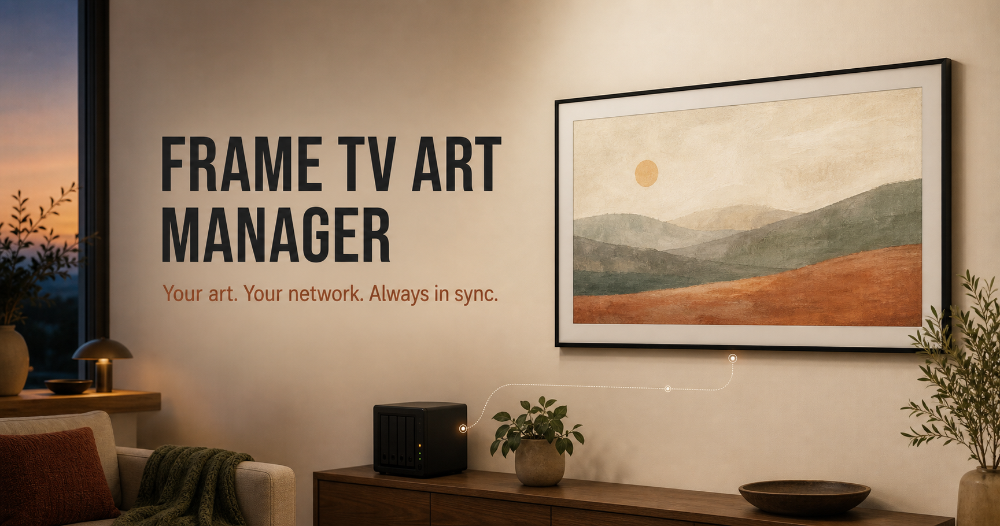

# Frame TV Art Manager

[](https://github.com/MikeO7/frame-tv-art-manager/actions/workflows/ci.yml)
[](https://mikeo7.github.io/frame-tv-art-manager/)

[](https://mikeo7.github.io/frame-tv-art-manager/)

**Keep your Samsung Frame TV's art in sync with a folder on your home server.**

Frame TV Art Manager is a self-hosted service that automatically uploads your
photos and artwork to Samsung Frame TVs (The Frame) from a NAS or home server.
Drop JPEG or PNG files into a folder; it prepares them for the 4K screen and
keeps every Frame TV in your house up to date over your local network, without
SmartThings or a Samsung account. When a TV runs out of space, it rotates your
collection through automatically. It runs in Docker and is free for personal,
noncommercial use.

[Project website](https://mikeo7.github.io/frame-tv-art-manager/) ·
[Quick start](#quick-start-with-docker-compose) ·
[Apple Photos guide](https://mikeo7.github.io/frame-tv-art-manager/guides/apple-photos-to-samsung-frame-tv.html) ·
[All settings](.env.example)

> [!IMPORTANT]
> This is source-available software under the
> [PolyForm Noncommercial License 1.0.0](LICENSE), not an open-source license.
> Personal and other noncommercial use is allowed; commercial use is not. The
> project is independent and not affiliated with or endorsed by Samsung.

## Features

- **Folder in, art on the TV.** Add or remove files and the TV follows on the
  next sync. Unchanged files are never uploaded twice.
- **Several TVs, one collection.** List every TV's address and each one is kept
  in sync on its own.
- **Ready for the screen.** Photos are rotated upright, cropped or padded to
  fit, color-corrected, gently sharpened, and saved at 3840×2160 by default.
- **Automatic rotation when the TV is full.** Each piece stays up for two weeks
  (configurable), then makes room for art that hasn't been shown yet.
- **Many ways to add art.** A local folder, a password-protected web uploader
  (works with iPhone Shortcuts), or online sources: Unsplash, NASA, the Art
  Institute of Chicago, Pexels, Pixabay, and direct image links.
- **Careful by default.** It only removes art it uploaded, leaves your own TV
  uploads alone, and makes no changes when it can't be sure of the TV's state.
- **Optional TV controls.** Slideshow settings, fixed or sun-following
  brightness, a nightly power-off time, and Wake-on-LAN.

## Is it right for you?

You need:

- A Samsung Frame TV running **Tizen 8.0 or newer**. Older firmware may
  work, but Samsung's private Art Mode protocol changes between models and
  releases.
- Something that runs all the time and can reach the TV on your network: a
  NAS (Synology, Unraid, TrueNAS), a mini PC, a Raspberry Pi–class Linux box,
  or a Mac.
- A fixed IP address for the TV (set a DHCP reservation in your router).

If you only upload the occasional photo from your phone, Samsung's SmartThings
app is simpler. This project is for people who want a collection that keeps
itself up to date.

## Quick start with Docker Compose

Create a folder for the service and save this as `compose.yaml`:

```yaml
services:
  frame-tv-art-manager:
    image: ghcr.io/mikeo7/frame-tv-art-manager:latest
    container_name: frame-tv-art-manager
    restart: unless-stopped
    environment:
      TV_IPS: "192.168.1.150"        # your TV's address; comma-separate several
      CLIENT_NAME: "Frame Art Manager"
    ports:
      - "8080:8080"
    volumes:
      - ./data:/data
```

Start it and watch the logs:

```bash
docker compose up -d
docker compose logs -f frame-tv-art-manager
```

1. **Approve the connection.** The first time it connects, the TV shows an
   Allow/Deny prompt named after `CLIENT_NAME`. Choose **Allow** with the remote.
   The pairing token is saved in `./data/tokens`; keep that folder when you
   upgrade or the TV will ask again.
2. **Add art.** Copy `.jpg`, `.jpeg`, or `.png` files into `./data/artwork`.
3. **Wait for a sync.** The first sync runs at startup, then every 30 minutes
   (`SYNC_INTERVAL_MINUTES`).

The image runs on `amd64`, `arm64`, and `armv7`. If the container can't write to
`./data`, create the folders yourself with `mkdir -p data/artwork data/tokens`.
To set file ownership, use `PUID` and `PGID`. To run as a non-root user instead,
own both folders yourself, add `user: "<uid>:<gid>"` to the service, and leave
`PUID`/`PGID` unset.

## Adding artwork

### A folder

The `artwork` folder is your collection. Add files to put them on the TV and
delete files to take them off. Identical files are detected by their contents,
so the same image is never uploaded twice. Other files in the folder (JSON,
YAML, hidden and temporary files, symlinks) are ignored.

Images the manager prepares are renamed to a readable name plus a short content
hash, for example `summer-vacation--8f14e45fceea167a.jpg`.

### The web uploader

Turn on the built-in upload page:

```yaml
    environment:
      UPLOAD_ENABLED: "true"
      UPLOAD_TOKEN: "a-long-random-password"   # at least 16 characters
```

Then open `http://<server-address>:8080/upload`, sign in as `frame` with your
`UPLOAD_TOKEN`, and choose JPEG or PNG files. The same address accepts a
multipart `POST` with a field named `file`, so iPhone and Mac Shortcuts and
`curl` work too:

```bash
curl -u "frame:$UPLOAD_TOKEN" -F "file=@photo.jpg" http://<server-address>:8080/upload
```

Each upload is checked as a real image and is limited to
`MAX_DOWNLOAD_SIZE_MB` (20 MB by default). The page uses plain HTTP Basic
authentication, so keep it on your home network or behind a TLS reverse proxy,
and never expose port 8080 to the internet. The
[Apple Photos guide](https://mikeo7.github.io/frame-tv-art-manager/guides/apple-photos-to-samsung-frame-tv.html)
walks through iPhone, iPad, and Mac setups; the repository keeps
[detailed notes](docs/apple-photos-sync.md).

### Online sources

Point `ARTWORK_SOURCES_FILE` at a YAML file in your data folder, for example
`ARTWORK_SOURCES_FILE=/data/sources.yaml`. If the file doesn't exist, a
commented starter file is created for you.

```yaml
providers:
  unsplash:
    - collection:225444
    - photo:L9W_5q57_V8
  nasa:
    - apod
    - search:james webb
  art_institute_of_chicago:
    - search:monet
    - photo:20684
  pexels:
    - curated
    - search:architecture
  pixabay:
    - editors_choice
    - search:mountains
  direct:
    - https://example.com/image.jpg
```

| Provider | Commands | API key |
| --- | --- | --- |
| Unsplash | `collection`, `photo` | `UNSPLASH_ACCESS_KEY` |
| NASA | `apod`, `search` | `NASA_API_KEY` (defaults to `DEMO_KEY`) |
| Art Institute of Chicago | `search`, `photo` | none |
| Pexels | `search`, `curated`, `collection`, `photo` | `PEXELS_API_KEY` |
| Pixabay | `search`, `editors_choice`, `photo`, `user` | `PIXABAY_API_KEY` |
| Direct link | any HTTP or HTTPS image URL | none |

A plain list, a top-level `sources:` list, or a text file with one source per
line (`#` for comments) also works. Downloads go into your collection like any
other file. If any source fails during a sync, nothing previously downloaded is
removed. Removing a source from the file doesn't delete what it already
downloaded; delete those files yourself if you no longer want them. Each
provider has its own rate limits and terms.

## How syncing works

Every sync does the same thing:

1. Download anything new from your online sources.
2. Check the collection and prepare any images that need it.
3. Connect to each TV and read what's on it.
4. Upload what's missing and remove art you've deleted from the folder.
5. Apply any slideshow, brightness, or power settings you've configured.

The manager keeps a private record, per TV, of which art it uploaded. That
record decides what it is allowed to remove:

- **Art you added yourself is never removed.** Only `REMOVE_UNKNOWN_IMAGES=true`
  changes this, and that setting deletes everything the manager didn't upload.
- **The displayed artwork isn't changed.** The manager never selects a
  different piece. If it removes the piece on screen, the TV moves on to
  another one.
- **An empty folder doesn't empty the TV.** The last piece the manager uploaded
  stays up.
- **When in doubt, it waits.** If the TV's state or the collection can't be read
  completely, that TV is skipped until the next sync.

`DRY_RUN=true` runs the whole process read-only, without pairing, saving
anything, waking the TV, or uploading. It's useful to preview a new setup.

## When the TV is full: artwork rotation

Frame TVs hold a limited number of images. The manager learns a TV's limit the
first time the TV refuses an upload because its storage is full. From then on,
if your collection is bigger than the TV can hold, it **rotates**:

- Each piece the manager uploaded stays on the TV for at least
  `ROTATION_INTERVAL_DAYS` (default **14**; fractions such as `0.5` work).
- After that, it is swapped for art that is waiting. Pieces that have never
  been shown go first, then the ones that have been away longest.
- A piece that rotated out doesn't come back until it has been away just as
  long, so a large collection works through completely.
- Each swap removes one piece and immediately uploads its replacement, so the
  TV is never more than one image short.
- Only art the manager uploaded is rotated. Your own TV uploads stay, and the
  files in your collection are never deleted.

A full TV is then normal and healthy. `/status` shows `rotating`,
`artwork_waiting`, and `next_rotation` for each TV.

Some TVs limit storage by size rather than by count. If uploads keep failing
even after space was freed, rotation pauses after three failures in a row and
resumes once an upload succeeds.

Set `ROTATION_INTERVAL_DAYS=0` to turn rotation off. A full TV then reports
`storage full`, keeps what's on it, and stops uploading. It retries one upload
a day, or immediately once something on the TV is removed. Rotation also can't
help when the TV is full of art the manager didn't upload; that reports
`storage full` too.

## Image preparation

Preparation is on by default (`IMAGE_OPTIMIZE_ENABLED`). Images that need it
are:

- rotated upright using their EXIF orientation;
- fitted to the screen, either cropped, padded, or paired into a collage
  (see below);
- converted to sRGB when they carry an ICC color profile; HDR PNGs are
  tone-mapped to standard range;
- resized in linear light to exactly 3840×2160 (`IMAGE_MAX_WIDTH`,
  `IMAGE_MAX_HEIGHT`) and lightly sharpened;
- saved as JPEG quality 95. PNGs stay PNG, alpha included.

Portrait photos follow `PORTRAIT_MODE`:

| Mode | Result |
| --- | --- |
| `crop` (default) | Crops to fill the screen. |
| `pad` | Centers the photo on a blurred background. |
| `collage` | Places two portrait photos side by side. |

Optional, off by default:

- **Smart crop** (`SMART_CROP_ENABLED=true`) looks for the interesting part of
  the image instead of cropping the center. It only overrides the center crop
  when it's clearly better (`SMART_CROP_MIN_GAIN`), and it avoids cutting
  through skin tones, text, and fine detail.
- **External crop service** (`SMART_CROP_PROVIDER=http`) sends a small preview,
  at most 512 pixels, to a crop service you run. Low-confidence or failed
  answers fall back to the local crop.
- **Museum mode** (`IMAGE_MUSEUM_MODE=true`) adds a subtle canvas texture and
  warmth. `IMAGE_MUSEUM_INTENSITY` runs from 1 to 10 (default 5).

Each transform runs within a memory budget (`IMAGE_MAX_WORKING_MEMORY_MB`,
default 512 MB). A 24-megapixel camera photo takes about a second and roughly
250 MB, and 8K images fit within the default budget.

### Mattes

`MATTE_STYLE` sets Samsung's matte for every upload: `none` for full screen, or
a `style_color` value such as `shadowbox_polar` or `modern_apricot`.
`.env.example` lists every style and color. To give individual images their own
matte, add a `mattes.json` file to the artwork folder:

```json
{
  "_default": "modern_warm",
  "summer-vacation.jpg": "shadowbox_polar"
}
```

Keys are filenames; an override keeps working after the manager renames the
file. An invalid `mattes.json` stops the sync before any TV is touched, so
mistakes don't go unnoticed.

## Configuration

`TV_IPS` is the only required setting. Everything else has a sensible default.
The full, annotated list is in [`.env.example`](.env.example).

**Essentials**

| Variable | Default | Purpose |
| --- | --- | --- |
| `TV_IPS` | required | TV address, or several separated by commas |
| `SYNC_INTERVAL_MINUTES` | `30` | Time between syncs |
| `CLIENT_NAME` | `Frame Art Manager` | Name shown in the TV's Allow/Deny prompt |
| `ARTWORK_DIR` | `/data/artwork` | Your collection |
| `TOKEN_DIR` | `/data/tokens` | Pairing tokens and per-TV records |
| `ROTATION_INTERVAL_DAYS` | `14` | Days each piece stays on a full TV; `0` turns rotation off |
| `MATTE_STYLE` | `none` | Matte for every upload |
| `LOG_LEVEL` | `info` | `debug`, `info`, `warn`, or `error` |

**Images**

| Variable | Default | Purpose |
| --- | --- | --- |
| `PORTRAIT_MODE` | `crop` | `crop`, `pad`, or `collage` |
| `IMAGE_MAX_WIDTH` × `IMAGE_MAX_HEIGHT` | `3840` × `2160` | Output size |
| `IMAGE_JPEG_QUALITY` | `95` | JPEG quality (1–100) |
| `IMAGE_SHARPEN_AMOUNT` | `0.25` | Sharpening strength; `0` turns it off |
| `SMART_CROP_ENABLED` | `false` | Content-aware cropping |
| `IMAGE_MUSEUM_MODE` | `false` | Canvas texture and warmth |
| `IMAGE_OPTIMIZE_ENABLED` | `true` | Turn all preparation off with `false` |
| `MAX_ARTWORK_IMAGES` | `0` | Limit on collection size; `0` means no limit |
| `MAX_DOWNLOAD_SIZE_MB` | `20` | Largest download or upload accepted |

**Uploads, safety, and the web server**

| Variable | Default | Purpose |
| --- | --- | --- |
| `UPLOAD_ENABLED` | `false` | Turn on the `/upload` page |
| `UPLOAD_TOKEN` | — | Upload password, at least 16 characters |
| `REMOVE_UNKNOWN_IMAGES` | `false` | Also delete TV art the manager didn't upload (destructive) |
| `DRY_RUN` | `false` | Plan without changing anything |
| `HEALTH_PORT` | `8080` | Port for status and uploads; `0` turns the server off |
| `HEALTH_BIND_ADDRESS` | `0.0.0.0` | Address to listen on, e.g. `127.0.0.1` behind a local proxy |

Invalid values such as an unknown log level, an unsupported slideshow
interval, or a bad TV address stop the service at startup with a clear error.
A number or true/false value that can't be read falls back to its default and
logs a warning.

## TV controls

All of these are optional. If you don't set them, the manager leaves the TV's
own settings alone.

- **Slideshow.** Setting any of `SLIDESHOW_ENABLED`, `SLIDESHOW_INTERVAL`
  (3, 15, 60, 720, or 1440 minutes), or `SLIDESHOW_TYPE` (`shuffle` or
  `sequential`) puts the manager in charge of the slideshow.
- **Brightness.** `BRIGHTNESS` sets a fixed level (0–50). Alternatively,
  `SOLAR_BRIGHTNESS_ENABLED=true` with `LOCATION_LATITUDE`,
  `LOCATION_LONGITUDE`, and `LOCATION_TIMEZONE` follows the sun between
  `BRIGHTNESS_MIN` and `BRIGHTNESS_MAX`.
- **Nightly power-off.** `AUTO_OFF_TIME` (for example `22:00`, in
  `LOCATION_TIMEZONE`) turns off TVs that are showing art, and leaves TVs that
  are in use alone. It keeps trying for `AUTO_OFF_GRACE_HOURS` (default 2).
- **Wake-on-LAN.** `TV_MAC` wakes a single TV when it is confirmed off. It is
  never sent when the TV's state is unknown, and it is turned off when
  `TV_IPS` lists several TVs.

Network options for unusual setups:

- `ENABLE_REST_GATE=true` checks the TV's REST endpoint before connecting,
  which can avoid pop-ups while you're watching other content. It's
  firmware-dependent and off by default.
- TLS verification is off because Frame TVs use self-signed certificates. Set
  `VERIFY_TLS=true` only if your TV's certificate can be verified.

## Monitoring

The built-in web server (port `HEALTH_PORT`) provides:

| Endpoint | Purpose |
| --- | --- |
| `GET /live` | The process is running. The container healthcheck uses this. |
| `GET /ready`, `GET /health` | 200 once startup finished and the last sync succeeded, otherwise 503. |
| `GET /status` | Timing, current stage, last error, and per-TV status, including rotation. |
| `GET` / `POST /upload` | The upload page, when uploads are enabled. |

Logs are JSON. Each TV's result includes its address, status, upload and delete
counts, and the full error when something fails. Errors from the TV also carry
`error_kind`, `operation`, and `retryable` fields for filtering.

A failing healthcheck doesn't restart the container by itself. Use a restart
policy such as `restart: unless-stopped` if you want automatic recovery.

## Troubleshooting

**The TV never shows an Allow/Deny prompt.** Check that the TV is on, in Art
Mode, and reachable from the server (`ping`). If you denied it before, remove
the entry under the TV's device connection settings and restart the container.

**Status says `skipped (not art mode)` or `skipped (powered off)`.** The TV is
off or showing other content. The manager waits and tries again at the next
sync. With `TV_MAC` set, it can wake a TV that is off.

**Status says `backoff` or `unreachable`.** The TV didn't answer. Repeated
failures wait progressively longer between attempts, up to an hour. Check the
TV's IP address and that the server and TV are on the same network.

**Status says `storage full`.** Rotation is off, or the TV is full of art the
manager didn't upload. See [artwork rotation](#when-the-tv-is-full-artwork-rotation).

**Status says `recovery required`.** An upload or delete was interrupted
before the manager could confirm the result, for example by a restart
mid-transfer. To avoid duplicates or wrong deletions, that TV is paused until
the result can be confirmed. If it doesn't clear on later syncs, stop the
container and delete that TV's `tv_*_reconciliation.json` file in the tokens
folder. The manager then forgets which art it uploaded: existing art stays on
the TV as if you had added it, and your collection is uploaded again.

**Permission errors on `/data`.** See the ownership notes in the
[quick start](#quick-start-with-docker-compose).

Still stuck? [Open an issue](https://github.com/MikeO7/frame-tv-art-manager/issues)
with your TV model, firmware version, and the relevant log lines.

## Running without Docker

Build with the Go version in [`go.mod`](go.mod):

```bash
go build -o frame-tv-art-manager ./cmd/frame-tv-art-manager
TV_IPS=192.168.1.150 \
ARTWORK_DIR="$PWD/data/artwork" \
TOKEN_DIR="$PWD/data/tokens" \
./frame-tv-art-manager
```

The binary also supports `--help`, `--version`, `-healthcheck`, and
`-livenesscheck`.

## Development

```bash
make tools       # install the pinned linter and pre-commit
make test        # tests with a coverage profile
make race        # tests under the race detector
make e2e         # browser journeys against the real binary
make agent-fix   # the full gate: format, lint, hooks, tests, coverage, vulnerability scan
```

`make agent-fix` must pass before a change is complete. See
[CONTRIBUTING.md](CONTRIBUTING.md) and [AGENTS.md](AGENTS.md) for the
engineering rules.

The end-to-end journeys need Node.js 26 and pnpm 12. They start the real binary
with temporary folders and a fake TV address, and never contact a real TV:

```bash
pnpm install --frozen-lockfile
pnpm exec e2e-web install chromium   # add --with-deps on a Linux host without browser libraries
make e2e
```

Every pull request runs one [CI workflow](.github/workflows/ci.yml): lint,
hooks, tests, race tests, a vulnerability scan, the end-to-end journeys, and a
container build with a smoke test. Merging to `main` publishes the multi-arch
image to GHCR only after all of them pass, and `v*` tags also publish a GitHub
release.

## FAQ

**Can it automatically upload art to a Samsung Frame TV?**
Yes. It checks a folder on a schedule (every 30 minutes by default) and uploads
new images to every configured Frame TV over your local network.

**Do I need SmartThings or a Samsung account?**
No. It talks directly to the TV on your network. Only optional online sources
such as Unsplash or NASA contact the internet.

**Which Frame TVs does it support?**
Samsung Frame TVs running Tizen 8.0 or newer. Older firmware may work, but
Samsung's private Art Mode protocol varies between models and releases.

**What happens when the Frame TV's storage is full?**
It rotates art: each piece stays at least 14 days by default
(`ROTATION_INTERVAL_DAYS`), then is swapped for art that hasn't been shown yet.
Your own TV uploads and your local files are never deleted.

**Will it delete art I uploaded to the TV myself?**
No. It only removes art it uploaded, unless you turn on
`REMOVE_UNKNOWN_IMAGES`.

**Does it work with portrait photos?**
Yes. Portrait photos are cropped to fill the screen by default, or padded on a
blurred background, or paired side by side (`PORTRAIT_MODE`). Output is
3840×2160 by default.

**Can I send photos from an iPhone or Apple Photos?**
Yes. Turn on the password-protected upload page and use an iPhone or Mac
Shortcut; see the
[Apple Photos guide](https://mikeo7.github.io/frame-tv-art-manager/guides/apple-photos-to-samsung-frame-tv.html).

**Can I run it on Synology, Unraid, or a Raspberry Pi?**
Yes, anywhere Docker runs and the TV is reachable on the network. The image
supports `amd64`, `arm64`, and `armv7`.

**Is it open source?**
It is source-available under the PolyForm Noncommercial License 1.0.0: free for
personal and other noncommercial use, but commercial use is not permitted, so
it is not open source by the OSI definition.

## License

[PolyForm Noncommercial License 1.0.0](LICENSE). Personal and other
noncommercial use is allowed; commercial use is not.
